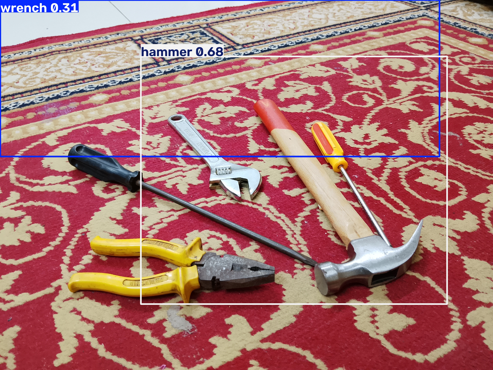
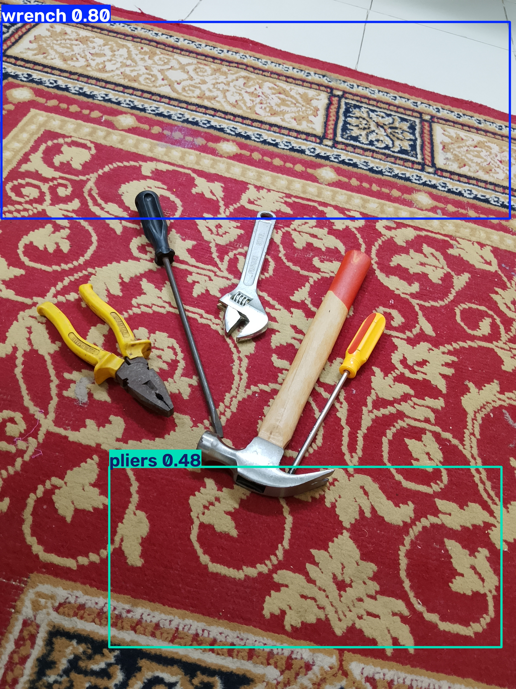
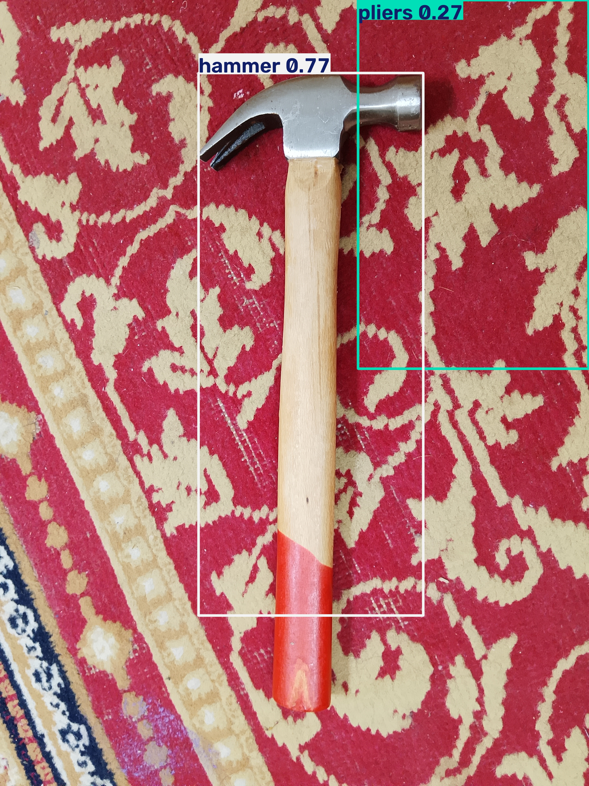
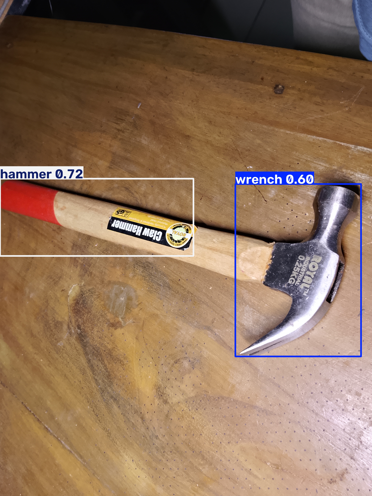
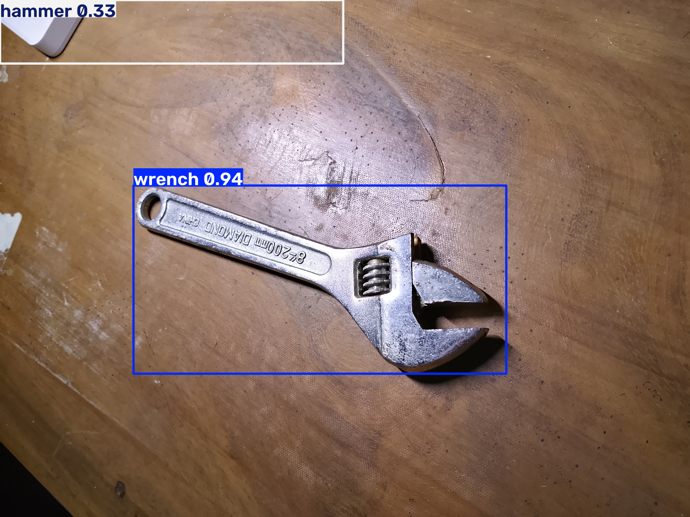

# ToolVision Detector: Synthetic vs. Real

Detecting 4 hand tools (wrench, screwdriver, hammer, pliers) with a YOLO26n model trained on synthetic data generated in Blender + BlenderProc, then tested on real photos from locations the model never saw.

**Live demo:** https://huggingface.co/spaces/moindedroper/toolvision-detector  
**Reproduce it:** https://www.kaggle.com/code/moindedroper/toolvision-synthetic-vs-real-hand-tool-detection
**Dataset:** https://www.kaggle.com/datasets/moindedroper/toolvision-data


> **Summary:** 1,350 synthetic images alone reached **mAP50 0.681** on real photos. ~35 real photos alone reached **0.046**. Adding a small amount of real data to the synthetic set changed *how* the model fails more than *how much*.

---

## 1. Problem

Collecting and labeling real images for object detection is slow and expensive. This project asks two questions. How far can synthetic data alone get you? And what changes when you add a small number of real photos?

## 2. Method

- **Synthetic data:** 1,350 images rendered in Blender with BlenderProc. Each image randomizes object pose, materials, lighting, camera angle and distance, backgrounds, and distractor objects. Labels are exported automatically, with no hand labeling.
- **Real data:** phone photos labeled in CVAT and exported to YOLO format.
- **Model:** Ultralytics YOLO26n, trained locally on an RTX 3080. Image size [IMGSZ]. Epochs are listed per experiment.
- **Demo:** Experiment B, exported to [ONNX/TFJS], runs fully in the browser on a static Hugging Face Space, with no server and no GPU. See section 5 for why B was chosen.

## 3. Data split

| Set | Images | Tools | Source | Used for |
|---|---|---|---|---|
| Synthetic | 1,350 | [ ] | Blender render | Training |
| Real training pool | ~35 | [ ] | 1 location | Training / fine-tuning |
| Held-out real test | 106 | 178 | [N] other locations | **Evaluation only** |

The test photos come from locations that never appear in any training set. The split was made **before** labeling. No test image was used for training, tuning, or model selection. Full details are in [`docs/split_note.md`](docs/split_note.md).

## 4. Results

All experiments are evaluated on the same held-out real test set: 106 images containing 178 tools.

| Exp | Training data | mAP50 | mAP50-95 | Precision | Recall |
|---|---|---|---|---|---|
| A | 1,350 synthetic | 0.681 | 0.409 | 0.782 | 0.578 |
| B | 1,350 synthetic + 30 real, mixed | 0.658 | **0.440** | **0.827** | 0.522 |
| C | ~35 real (1 location), 100 epochs | 0.046 | 0.021 | 0.259 | 0.070 |
| C-e300 | same, 300 epochs | 0.009 | 0.002 | 0.014 | 0.174 |
| D | A, gently fine-tuned on ~35 real | **0.693** | 0.397 | 0.674 | **0.652** |

### mAP50 per tool

| Exp | Wrench | Screwdriver | Hammer | Pliers |
|---|---|---|---|---|
| A | 0.770 | 0.590 | **0.842** | 0.521 |
| B | 0.793 | **0.655** | 0.664 | 0.521 |
| C | 0.027 | 0.063 | 0.045 | 0.049 |
| C-e300 | 0.001 | 0.020 | 0.016 | 0.001 |
| D | **0.800** | 0.588 | 0.829 | **0.553** |

### mAP50-95 per tool (box tightness)

| Exp | Wrench | Screwdriver | Hammer | Pliers |
|---|---|---|---|---|
| A | 0.561 | 0.397 | **0.441** | 0.238 |
| B | **0.632** | **0.456** | 0.329 | **0.342** |
| D | 0.558 | 0.361 | 0.431 | 0.237 |

### Confusion matrix (Exp B)


### Key findings

1. **Synthetic data alone did most of the work.** With no hand-labeled training images, A reached mAP50 0.681 on real photos from unseen locations.
2. **~35 real photos from a single location did not generalize.** C reached 0.046. Training for 300 epochs made it worse (0.009), which is a clear sign of overfitting. With this little data, the result can't separate the effect of too few images from the effect of only one location. Both are likely factors.
3. **A, B and D are close overall.** mAP50 ranges from 0.658 to 0.693, which is within noise for a 106-image test set. The real differences are in *how* each model behaves.
4. **Mixing in real photos (B) gave the tightest boxes and fewest false detections.** B had the best mAP50-95 (0.440) and precision (0.827). The biggest box-tightness gains were for wrench (0.561 → 0.632) and pliers (0.238 → 0.342).
5. **Fine-tuning (D) found the most tools.** D had the highest recall (0.652) and the highest mAP50 (0.693), but lower precision (0.674), so it draws more false boxes.
6. **The screwdriver improved in B but not in D** (0.590 → 0.655 vs 0.588). One possible explanation, not yet tested: in B the real photos, including a long black screwdriver, were present for the whole training run with all layers free to learn. In D, frozen layers and a low learning rate may have limited how much the model could adapt to the long-shaft shape.
7. **The hammer dropped sharply in B** (mAP50 0.842 → 0.664, recall 0.787 → 0.52). That is roughly 6–9 more missed hammers, which is too many to blame on noise. The cause is not known yet; see section 6.

## 5. Model chosen for the demo: B

The selection criterion was the experience of a stranger using the demo. A false box drawn on the carpet hurts trust more than one missed tool. B has the highest precision (fewest false boxes) and the tightest boxes, so B is the demo model, even though D has a slightly higher mAP50.

## 6. Failure cases

| # | Image | Model | What went wrong | Likely reason |
|---|---|---|---|---|
| 1 |  | B | Hammer missed (A found it) | [ ] |
| 2 |  | B | Hammer missed (A found it) | [ ] |
| 3 |  | A | Long-shaft screwdriver missed | No long-shaft screwdriver model in the synthetic set |
| 4 |  | [ ] | Tool with yellow handle missed | Handle colors not randomized in synthetic set |
| 5 |  | [ ] | False box on patterned floor | Few patterned floor textures in synthetic set |
| 6 |  | [ ] | [ ] | [ ] |

**Priority:** compare the hammers that B misses against A's detections on the same images, to find what the 30 real photos changed.

## 7. Improvements (synthetic v2)

- Add a long-shaft screwdriver model.
- Randomize handle colors, including yellow.
- Add more patterned floor textures.
- Investigate the hammer regression in B before adding more real data.
- Collect the real training pool across several locations instead of one.
- Try a permissively licensed detector such as RF-DETR.

## 8. Reproduce

```bash
git clone [REPO_URL]
cd [REPO]
pip install -r requirements.txt
python train.py --data configs/exp_b.yaml   # adjust to your scripts
python eval.py --weights runs/exp_b/best.pt --data configs/test_real.yaml
```

Or run the [Kaggle notebook]([KAGGLE_NOTEBOOK_LINK]).

## 9. License notes

- Code: [MIT / Apache-2.0]
- Training uses Ultralytics YOLO, which is **AGPL-3.0**. That is fine for research and portfolio use; commercial deployment may require an Ultralytics enterprise license.
- Dataset license: see the [ToolVision dataset card]([TOOLVISION_DATASET_LINK]).

## Contact

MD Moinul Islam · [LinkedIn] · [email] · open to synthetic data and computer vision projects.
